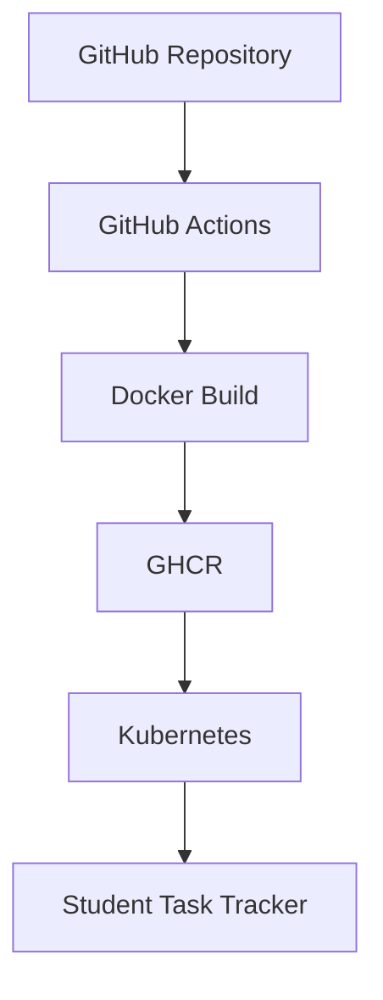

# Student Task Tracker

## Overview

The Student Task Tracker is a simple application
that helps students organize and complete their
assignments and weekly tasks.

This application is being developed as the final
project for IT 390: Introduction to Containers
at DePaul University.

## Features

Planned features include:
- Display a list of student assignments and tasks
- Add new tasks
- Mark tasks as completed
- Filter tasks by completion status

## Technologies

The project will use:
- Docker for containerization
- Docker Compose for running multiple services
- GitHub Actions for CI/CD
- GitHub Container Registry (GHCR) for image storage
- Kubernetes for deployment and management

## CI/CD Pipeline

GitHub Actions automates the application's
testing, building, and publishing process.

The pipeline is designed to:
1. Run when code is pushed or a pull request is opened.
2. Run automated tests or lint checks.
3. Build a Docker image.
4. Publish the image to GHCR with a commit SHA tag.

Currently, only the initial workflow checks are
implemented.

## Running the Application

Instructions will be added once the Dockerfile
and Docker Compose configuration are complete.

## Environment Variables

Environment variable instructions will be
added once the application configuration is finalized.

## Kubernetes Deployment

Deployment instructions will be added once
the Kubernetes manifests are complete.

## Architecture

The following diagram shows the planned
CI/CD and deployment architecture.

