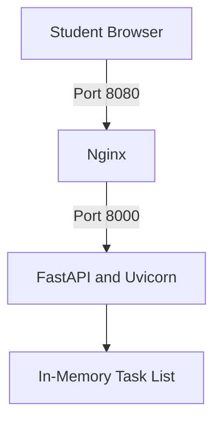
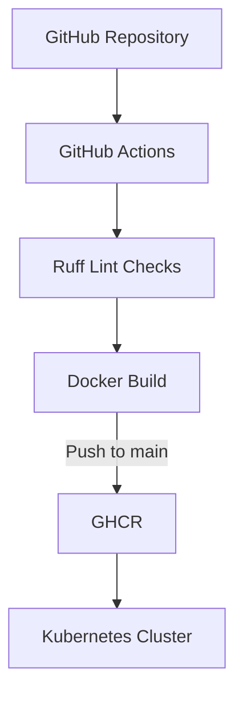

# Task Flow - Student Task Tracker

## Overview

Task Flow is a simple web application that helps
students organize and complete their assignments
and weekly tasks.

Developed by the Task Flow Team for IT 390:
Introduction to Containers at DePaul University.

## Features

- View a list of student assignments and tasks.
- Add new tasks.
- Mark tasks as completed.
- Retrieve task data through a REST API.
- Customize the application heading using an
  environment variable.

## Technologies

- Python 3.12
- FastAPI
- Uvicorn
- Nginx
- Docker
- Docker Compose
- GitHub Actions
- GitHub Container Registry (GHCR)
- Kubernetes
- Ruff

## Running the Application

### Prerequisites

- Git
- Python 3.12
- Docker with Docker Compose
- kind and kubectl for Kubernetes deployment

### Local Python

From the repository directory, run:

```bash
python3 -m venv .venv
source .venv/bin/activate
pip install -r requirements.txt
uvicorn main:app --host 0.0.0.0 --port 8000
```

Open http://localhost:8000.

### Standalone Docker

Build the application image:

```bash
docker build -t student-task-tracker .
```

Start the container:

```bash
docker run --rm -p 8000:8000 student-task-tracker
```

Open http://localhost:8000.

### Docker Compose

Make sure Docker is installed and running.

Clone the repository:

```bash
git clone https://github.com/depaul-teaching/student-task-tracker.git
cd student-task-tracker
```

Build and start the services:

```bash
docker compose up --build
```

Open the application at:

http://localhost:8080

Stop the services:

```bash
docker compose down
```

## Environment Variables

| Variable | Default | Purpose |
|---|---|---|
| APP_TITLE | Task Flow - Student Task Tracker | Controls the visible page heading |
| APP_HOST | app | Nginx upstream hostname |
| APP_PORT | 8000 | Nginx upstream port |

To customize the application heading, run:

```bash
APP_TITLE="My Assignment Tracker" docker compose up --build
```

APP_HOST and APP_PORT are configured in compose.yaml.

## API Endpoints

| Method | Endpoint | Description |
|---|---|---|
| GET | / | Displays the task tracker |
| GET | /health | Returns application health status |
| GET | /api/tasks | Returns task data as JSON |
| POST | /add | Adds a new task |
| POST | /complete/{task_id} | Marks a task as completed |

## CI/CD Pipeline

GitHub Actions automates the application's
linting, building, and image publishing process.

The workflow runs on pushes and pull requests
targeting the main branch.

The pipeline performs the following steps:

1. Checks out the repository.
2. Sets up Python 3.12.
3. Installs Ruff.
4. Runs Python lint checks.
5. Sets up Docker Buildx.
6. Builds the Docker image.
7. Publishes the image to GHCR on pushes to main.

Published images are tagged with the full Git
commit SHA using the sha- prefix.

Pull requests build the image without publishing it.

Container registry:

`ghcr.io/depaul-teaching/student-task-tracker`

## Application Architecture



Docker Compose connects the FastAPI application
and Nginx supporting service.

The application container uses a non-root user
to reduce security risks.

## CI/CD Architecture



## Kubernetes Deployment

Kubernetes deployment instructions will be
added once the deployment manifests are finalized.

## Architecture Notes

FastAPI provides both the web interface and API
endpoints. Nginx acts as a reverse proxy, separating
the public-facing entry point from the application.

Docker Compose provides a reproducible local
environment for both services.

GitHub Actions runs lint checks before building
the image. SHA-based tags allow specific application
versions to be identified and deployed.

In-memory storage was chosen to keep the application
simple and prioritize container infrastructure.
The tradeoff is that task data does not persist
across container restarts or synchronize across
replicas.

## Troubleshooting

### Ruff Import Order Error

The CI pipeline initially failed after the application
code was added. Inspection of the GitHub Actions
logs revealed a Ruff I001 import-order error in main.py.

The issue was resolved by grouping Python standard
library imports separately from third-party imports.

After committing the correction, the workflow passed
and successfully published the Docker image to GHCR.
This demonstrated how automated checks prevent code
quality issues from progressing through the pipeline.

## Known Limitations

Tasks are stored in memory rather than in a
persistent database. Restarting the application
resets the task list.

Multiple application replicas maintain separate
task lists.

## Team Members

- Melanie Vu
- Joe Harmanos
- Demetri Frangiadakis
